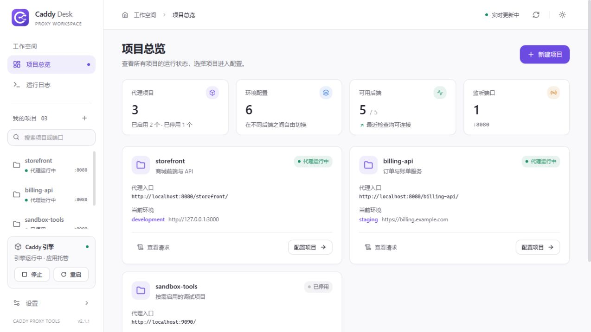
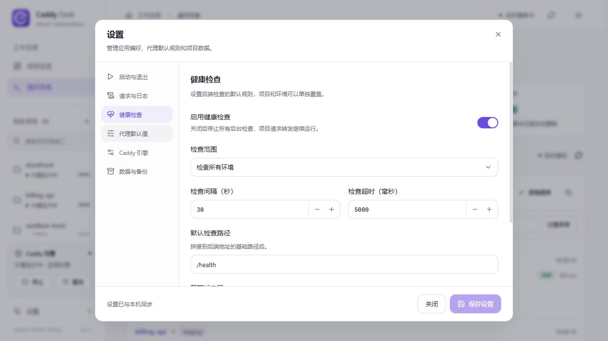

<p align="center"></p>

# Caddy Proxy Tools

面向本地开发的 Caddy 反向代理桌面工具。用固定入口连接不同后端，按项目切换环境，并直接查看请求、代理状态和引擎日志。界面中的工作空间也称为 Caddy Desk。

[下载 Windows 安装包](../../releases/latest) · [使用说明](docs/USAGE.md) · [更新日志](CHANGELOG.md) · [参与贡献](CONTRIBUTING.md)



## 能做什么

- 按项目管理本地入口、开发 / 预发布等环境，单独启停需要的项目。
- 共用端口时按路径分流，支持自定义匹配前缀和转发路径。
- 按项目查看请求的方法、原始路径、转发后端、状态码和耗时，筛选异常与慢请求。
- 分别查看软件事件和 Caddy 日志，收起例行信息、合并重复记录并保留原始详情。
- 设置健康检查、超时、Host 与请求 / 响应 Header；全局默认值可由项目和环境覆盖。
- 导入 / 导出项目、自动备份与恢复，配置启动、自启和关闭窗口后的行为。
- 支持深浅主题，安装包内置 Caddy，无需另行安装 Caddy 服务。

## 安装与支持范围

当前验证并发布 **Windows x64** 的 EXE 与 MSI 安装包，请在 [Releases](../../releases/latest) 下载，并按需核对同页的 `SHA256SUMS.txt`。macOS / Linux 的源码与资源尚未经过完整安装验证，暂不提供支持承诺。

## 快速上手

1. 启动应用并创建项目，设置监听端口，例如 `8080`。
2. 添加环境，将后端填为已运行服务的地址，例如 `http://127.0.0.1:3000`。
3. 启用项目并启动 Caddy，使用界面显示的完整代理入口访问服务。
4. 在项目中切换环境，或到「运行日志 → 请求记录」查看请求转发结果。

共用端口时，为所有相关项目开启路径前缀。也可以从「设置 → 数据与备份」导入 [示例项目](examples/projects.json)；示例默认停用，配置好本地服务后再启用。


## 应用设置与数据

设置包含「启动与退出」「请求与日志」「健康检查」「代理默认值」「Caddy 引擎」「数据与备份」六类。代理参数按全局、项目、环境逐层继承，详细规则见 [使用说明](docs/USAGE.md)。

Windows 配置默认保存在 `%APPDATA%\com.caddy-proxy-tools.desktop\config.json`，自动备份位于同目录的 `backups`；可在数据与备份页查看和复制备份路径。用户配置、备份和日志不随源码上传。



以上截图使用示例数据，通过 `docs/preview.html` 渲染实际界面组件，不包含用户的项目、地址或请求日志。

## 从源码运行

安装 [Tauri 系统依赖](https://v2.tauri.app/start/prerequisites/) 和 Rustup，使用 Node.js **24.18.0**、pnpm **11.10.0**、Rust **1.96.1**。版本由仓库文件固定。

```sh
pnpm install --frozen-lockfile
pnpm download-caddy
pnpm tauri:dev
```

下载器固定 Caddy **2.11.4**，核对官方 SHA-512、固定归档 SHA-256 和二进制 SHA-256。已验证缓存可离线复用。完整环境、检查命令和升级步骤见 [开发文档](docs/DEVELOPMENT.md)。

## 构建与发布

```sh
pnpm test
pnpm build
cargo test --locked --manifest-path src-tauri/Cargo.toml
pnpm tauri:build
```

打包前会检查版本和更新日志，生成依赖许可声明；产物整理到 `artifacts/<版本>/`，包含安装包、中文更新日志、许可证及 SHA-256 文件。已有发布目录不会被覆盖。

GitHub Actions 在提交和 PR 上运行检查，推送与应用版本一致的 `v<版本>` 标签时构建并发布 Windows 安装包。首次公开的操作和仓库设置见 [开源发布说明](docs/OPEN_SOURCE.md)。

## 贡献与许可证

问题和建议请使用仓库 Issue 模板，代码贡献见 [CONTRIBUTING.md](CONTRIBUTING.md)。漏洞请按 [SECURITY.md](SECURITY.md) 私密反馈。

原创代码和图标使用 [MIT License](LICENSE)。Caddy、界面组件及其他依赖保留各自许可证，详见 [第三方软件声明](THIRD_PARTY_NOTICES.md) 和 `licenses/` 目录。公开的 TLS 测试身份仅用于自动测试，不得用于生产环境。
